# 🚀 ¡Hola! Soy Agustín Gonzalez
### 💻 Aspirable Desarrollador Full Stack

---

## 📌 Sobre Mí

- 🎓 Actualmente **finalizando la Tecnicatura Universitaria en Programación** en la **Universidad Tecnológica Nacional (UTN - FRSR)** en San Rafael, Mendoza, Argentina.
- 💡 Enfocado 100% en perfeccionar mis habilidades en el **desarrollo Web Full Stack**.
- 🛡️ Con la mira puesta a futuro en explorar y profundizar en la **Ciberseguridad** para crear software más seguro y robusto.
- 🎯 Buscando oportunidades para colaborar en proyectos desafiantes y seguir aprendiendo continuamente.

---

## 🛠️ Tech Stack

### **Editores de Codigo**

### **Lenguajes**

### **Frontend**

### **Backend**

### **Entornos**

---

## 📊 Estadísticas de GitHub

  
  

---

## 🧭 Mis Objetivos Activos

| Área | Estado | Meta |
| :--- | :---: | :--- |
| **Carrera** | 🎓 | Culminar Tecnicatura en Programación (UTN San Rafael) |
| **Especialidad** | 🚀 | Dominar ecosistema Full Stack (MERN/PERN Stack) |
| **Interés Futuro** | 🛡️ | Fundamentos de Web Security & Ethical Hacking |

---
